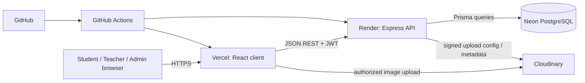
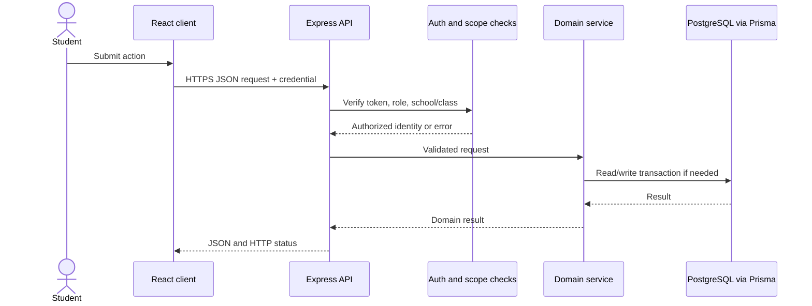

# 3. Technical Architecture

## Constraints and target stack
**JavaScript only:** backend files `.js` with ES Modules; React components `.jsx`; never create `.ts`/`.tsx`. Keep `client/` and `server/` separate. PostgreSQL is primary; Prisma handles data access and migrations. This is proposed; no implementation was found.

| Layer | Technology |
|---|---|
| Frontend | React, Vite, JavaScript, JSX, React Router, TanStack Query, CSS Modules or regular CSS |
| Backend | Node.js, Express, JavaScript ES Modules, REST, JWT, bcrypt, Zod |
| Database | PostgreSQL, Prisma, Prisma migrations; Neon hosted target |
| Images | Cloudinary using signed/controlled upload |
| Deployment | Render API, Vercel client, GitHub, GitHub Actions |

## System communication

Provider integrations are intended topology, not configured services.

## Frontend and backend structure
Frontend uses route-level pages/reusable components, isolated API services, React Router, and TanStack Query for server state. Forms provide UX validation; API validation is authoritative. Backend routes define contracts; middleware authenticates and authorizes; Zod validates params/query/body; domain services enforce rules and transactions; Prisma accesses data; centralized error middleware returns stable safe errors.



## Authentication, uploads, deployment
Use bcrypt; never store/log plaintext passwords. JWT secrets belong in environment-managed secret stores; define expiry, issuer/audience checks, refresh/revocation, and cookie versus bearer strategy before coding. Verify ownership and school/class scope server-side. The API alone accesses PostgreSQL. Store Cloudinary IDs and safe metadata, not binaries, in PostgreSQL; constrain file size/type and use signed or server-mediated uploads. Define evidence retention/deletion.

Vercel serves client; Render runs API; Neon hosts PostgreSQL; Cloudinary stores evidence. Separate environment credentials, CORS allowlists, HTTPS, health checks, backups, and reviewed migrations. GitHub Actions should run approved build/checks and deploy by environment policy.

## Recommended future layout
```text
client/src/{app,components,features,hooks,lib,pages,services,styles}
server/prisma/{schema.prisma,migrations,seed.js}
server/src/{config,middleware,modules,lib,app.js,server.js}
```
These are recommendations, not files created. See [Testing and Deployment](08-Testing-and-Deployment.md).
