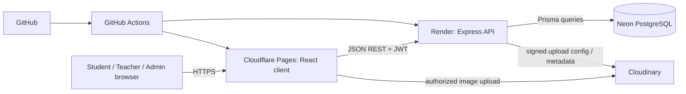
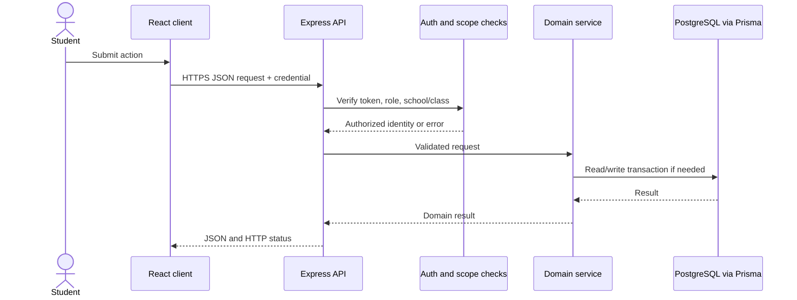

# 3. Technical Architecture

## Constraints and target stack
**JavaScript only:** backend files `.js` with ES Modules; React components `.jsx`; never create `.ts`/`.tsx`. Keep `frontend/`, `backend/`, and `database/` as separate top-level areas. PostgreSQL is primary; Prisma handles data access and migrations. These components are implemented; hosted services and production topology remain proposed.

| Layer | Technology |
|---|---|
| Frontend | React, Vite, JavaScript, JSX, React Router, TanStack Query, CSS Modules or regular CSS |
| Backend | Node.js, Express, JavaScript ES Modules, REST, JWT, bcrypt, Zod |
| Database | PostgreSQL, Prisma, Prisma migrations; Neon hosted target |
| Images | Cloudinary using signed/controlled upload |
| Deployment | Render API, Cloudflare Pages client, Neon PostgreSQL, GitHub Actions |

## System communication

Provider integrations are intended topology, not configured services.

## Frontend and backend structure
Frontend uses route-level pages/reusable components, isolated API services, React Router, and TanStack Query for server state. Forms provide UX validation; API validation is authoritative. Backend routes define contracts; middleware authenticates and authorizes; Zod validates params/query/body; domain services enforce rules and transactions; Prisma accesses data; centralized error middleware returns stable safe errors.



## Authentication, uploads, deployment
Use bcrypt; never store/log plaintext passwords. Password recovery stores only SHA-256 hashes of random, single-use tokens with a 30-minute expiry; completion revokes prior JWTs. Development returns a local reset link; production sends through Resend and requires `RESEND_API_KEY` and `MAIL_FROM`. JWT secrets belong in environment-managed secret stores; define expiry, issuer/audience checks, refresh/revocation, and cookie versus bearer strategy before coding. Verify ownership and school/class scope server-side. The API alone accesses PostgreSQL. Store Cloudinary IDs and safe metadata, not binaries, in PostgreSQL; constrain file size/type and use signed or server-mediated uploads. Define evidence retention/deletion.

Cloudflare Pages serves the Vite client; Render runs the Express API; Neon hosts PostgreSQL; Cloudinary stores evidence. The client uses `VITE_API_BASE_URL` as the API origin and appends `/api/v1`; leave it unset locally to use Vite's `/api` proxy. Configure Render `CLIENT_ORIGIN` with the exact deployed Pages origin. Separate environment credentials, HTTPS, health checks, backups, and reviewed migrations.

## Repository layout
```text
frontend/src/{components,lib,pages,App.jsx,main.jsx,styles.css}
backend/src/{config,middleware,modules,lib,routes,app.js,server.js}
backend/scripts/db/seed.js
database/prisma/{schema.prisma,migrations}
docs/
package.json
```
Root npm scripts install and run frontend/backend packages and call Prisma with the schema under `database/`. Teachers can edit lessons they authored and tasks they authored; admins can edit either content type. See [Testing and Deployment](08-Testing-and-Deployment.md).
