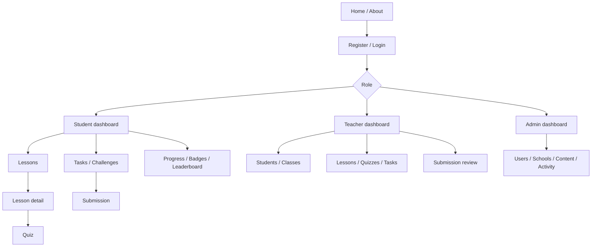

# 6. UI/UX Design

No finalized brand, colors, typography, illustration style, or wireframes were found. These decisions require approval; descriptions below define proposed experiences, not final visual design.

## Navigation

## Screens and behaviour
- **Public home/about:** approved purpose and entry points; no unsupported impact claims.
- **Authentication:** labeled forms, useful validation, password visibility, recovery path once defined; registration role follows policy.
- **Student dashboard:** next learning/action, due tasks, recent progress, points/achievements.
- **Lesson:** readable published content, progress, related quiz.
- **Quiz:** clear progress, keyboard controls, confirmation, result and explanation.
- **Task/submission:** criteria, deadline, accepted evidence, upload progress, review status, resubmission rules.
- **Leaderboard:** explicit scope/period, privacy-preserving names, accessible ranking and non-punitive presentation.
- **Profile/achievements:** personal history, badge criteria, points ledger, approved privacy controls.
- **Teacher dashboard:** only assigned classes; roster, content tools, pending reviews, progress summaries. Review shows criteria/evidence, safe preview fallback, decision and feedback.
- **Admin dashboard:** users, schools/classes, content, challenges/badges, activity; privileged actions clearly scoped, confirm consequential changes, and expose audit information.

## Responsive and shared states
Mobile-first layout, readable lesson width, touch-sized controls, responsive tables/cards, no horizontal scroll for core tasks. Upload must show requirements, progress, cancel/retry, and success. Loading preserves layout and announces state; errors explain recovery without traces; empty states explain next steps; timeouts never imply success; permission errors do not reveal protected resources; success confirms persisted state.

## Accessibility and decisions
Use semantic headings/landmarks, keyboard operation, visible focus, associated labels/errors, contrast, meaningful alt text, media captions/transcripts, dynamic status announcements, and never color alone. WCAG 2.2 AA is a proposed goal pending verification. Approval needed for brand, language, display-name/leaderboard opt-out policy, student consent, quiz pattern, upload limits, target devices, and wireframes.
